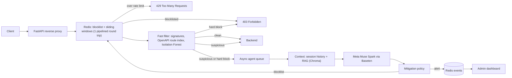

# SentinelAgent

**Autonomous AI-powered application and API security guard, deployed as a reverse proxy.**

SentinelAgent sits in front of your backend. Every request passes a synchronous, in-process filter
(signatures, OpenAPI schema checks, Isolation Forest, Redis sliding windows). Clean traffic is
forwarded immediately. Only suspicious requests are handed to an asynchronous agent that reasons
with Meta's open-weight **Muse Spark** model (served by Baseten), grounded by RAG over your OpenAPI
schemas and OWASP/CWE threat patterns. The agent then mitigates autonomously: it logs an alert or
writes the client to a Redis blocklist so its next request receives `403 Forbidden`.

Built for the Meta Global AI Developer Hackathon.

---

## Architecture



| Layer | Module | Runs on request path? |
| --- | --- | --- |
| Reverse proxy, streaming forwarder | `app/main.py` | yes |
| Sliding windows, blocklist, history, events | `app/redis_store.py` | yes (one pipelined round trip) |
| Signatures + Isolation Forest | `app/ml_filter.py` | yes (pure CPU, no I/O) |
| OpenAPI route index | `app/rag_engine.py` (`RouteIndex`) | yes (compiled regex match) |
| Vector retrieval (Chroma) | `app/rag_engine.py` (`RAGEngine`) | no, agent only |
| Meta model agent and mitigation | `app/agent_worker.py` | no, background workers |
| Dashboard and admin API | `app/dashboard.py`, `app/templates/` | admin routes only |

### Request lifecycle

| Fast-path outcome | Response | Agent |
| --- | --- | --- |
| Client on the blocklist | `403` immediately | not called |
| Over the sliding-window rate limit | `429` with `Retry-After` | not called |
| **Hard block** (traversal signature, score >= 0.9) | `403` immediately | analyzes in the background; may blocklist the client |
| **Suspicious** (score >= 0.45) | forwarded **without waiting** | analyzes in the background; may blocklist so the **next** request is `403` |
| **Clean** | forwarded immediately | not called |

Blocked responses use a uniform payload that reveals no detection internals:

```json
{"error": "forbidden", "message": "Request blocked by security policy.", "request_id": "6f0c..."}
```

Forwarded responses carry `X-Sentinel-Request-Id`, `X-Sentinel-Tier`, and `X-Sentinel-Guard-Ms`
(the time spent in the guard before forwarding).

### Latency

The hot path makes no network calls except one pipelined Redis round trip, and never waits on the LLM.
Scheme-relative targets such as `//host/path` are collapsed to a single path before inspection, and the
proxy refuses to send a request to any host other than `UPSTREAM_BASE_URL`.
The fitted Isolation Forest is compiled into flat Python lists (verified identical to scikit-learn's
`score_samples`) and memoized on quantized feature vectors. Each signature regex runs only if one of its
literal trigger substrings is present. On the development laptop (Python 3.14), the in-process work
(route match, feature extraction, scoring) took roughly 0.1 to 0.4 ms per request, including 4 KB JSON
bodies. Total guard overhead measured through `X-Sentinel-Guard-Ms` with in-memory Redis was 2 to 5 ms;
a real Redis on localhost adds one sub-millisecond round trip.

---

## How threats are detected

### Path traversal (CWE-22)

The raw, undecoded path, the query string, and the body are lowercased and URL-decoded up to three times,
which catches double encoding. They are then matched against signatures for:

- `../` and `..\` segments, `..%2f`, `%2e%2e%2f`, `%252e%252e` (double encoding), overlong UTF-8 (`%c0%ae`, `%c0%af`)
- sensitive targets: `/etc/passwd`, `/etc/shadow`, `/proc/self/`, `win.ini`, `boot.ini`, `.env`, `.git/config`, `.ssh/`
- null-byte truncation (`%00`) and stream wrappers (`file://`, `php://`, ...)

Any hit is a **hard block** (`403` on the first request). The agent then confirms intent with the model and,
if it is confident, blocklists the client for `BLOCK_TTL_SECONDS`.

### API intrusions: BOLA, mass assignment, undeclared operations

Once an OpenAPI schema is ingested, every request is matched against the declared operations:

- **BOLA (OWASP API1:2023):** the object ID is taken from the matched path parameter, or inferred from
  numeric, UUID, or ObjectId segments if no schema is loaded. Redis tracks the distinct IDs each client
  touches per route template in a sliding window. Enumeration past `BOLA_DISTINCT_THRESHOLD` makes the
  request suspicious, and the agent typically blocklists the client.
- **Mass assignment (API3:2023):** JSON body keys missing from the declared request schema are flagged.
  Privileged keys such as `role`, `is_admin`, `permissions`, `balance`, and `owner_id` score higher.
- **Undeclared methods and shadow endpoints (API5/API9:2023):** a method or path absent from the inventory is suspicious.
- **Type and enum violations:** for example `/users/{userId}` declared as an integer but receiving `..%2f..`.

The agent receives these deterministic findings together with the retrieved endpoint specification,
so the model reasons against the official contract.

### Other signals

Injection signatures (SQL tautologies, `UNION SELECT`, NoSQL operators, command chaining, `${jndi:`, script tags)
make a request suspicious. Special-character density and the Isolation Forest anomaly score catch unusual
request shapes. The sliding-window rate limit returns `429`.

---

## Meta model integration

`MetaModelClient` in `app/agent_worker.py` calls the Meta Model API, which is OpenAI-compatible:

```
POST {META_API_URL}/chat/completions
Authorization: Bearer $META_API_KEY
model: muse-spark-1.3
```

`META_API_URL`, `META_API_KEY`, and `META_MODEL` are read with `os.getenv`.

The model must return one JSON object:

```json
{"is_malicious": true, "confidence_score": 0.96, "threat_type": "path_traversal", "reasoning": "..."}
```

Muse Spark Open always reasons and does not support JSON mode, so the parser is defensive. It strips
`<think>` blocks and code fences, extracts the last JSON object containing `is_malicious`, coerces
`"true"` and percentage confidences (`87` becomes `0.87`), and maps aliases (`IDOR` to `bola`,
`directory_traversal` to `path_traversal`). Unparseable output never triggers a block; it is recorded as an alert.

The client retries timeouts, `429`, and `5xx` responses with exponential backoff. It sends
`x-session-affinity` per client IP to improve prompt-cache reuse. Request data is placed inside
`<request>` and `<history>` blocks that the system prompt declares untrusted, and `Authorization`,
`Cookie`, and API-key headers are redacted before anything reaches the model.

### Mitigation policy

| Condition | Action |
| --- | --- |
| Verdict missing or unparseable | `alert` |
| `is_malicious = false` | `ignored` (recorded as cleared by the agent) |
| `confidence >= BLOCK_CONFIDENCE` (0.85) | `blocklisted` |
| Threat type in {`path_traversal`, `bola`, `injection`} and `confidence >= CRITICAL_THREAT_CONFIDENCE` (0.7) | `blocklisted` |
| OpenAPI schema violation corroborates the verdict and `confidence >= 0.7` | `blocklisted` |
| Fast-filter hard block confirmed with `confidence >= 0.7` | `blocklisted` |
| Otherwise | `alert` |

Repeated flags from the same client, route, and threat within `AGENT_COOLDOWN_SECONDS` are analyzed
once, so a scanner cannot flood the model. If `META_API_KEY` is empty, the fast filter still blocks
signature hits and records alerts, but no LLM-driven blocklisting happens.

---

## Running locally

Requirements: Python 3.11 or newer (developed and tested on 3.14), plus Docker for Redis (optional).

```bash
python -m venv .venv
# Windows: .venv\Scripts\activate    macOS/Linux: source .venv/bin/activate
pip install -r requirements.txt
cp .env.example .env            # then set META_API_KEY and ADMIN_TOKEN
```

**Redis:** `docker compose up -d` starts Redis on `localhost:6379`. Without Docker, set
`REDIS_URL=memory://` to use an in-process Redis (single process only, state is lost on restart).

Start the demo backend, then the guard:

```bash
uvicorn examples.demo_backend:app --port 9000          # sample upstream API
uvicorn app.main:app --port 8000                       # SentinelAgent (UPSTREAM_BASE_URL=http://localhost:9000)
```

**No Baseten key yet?** Run the offline mock that speaks the same Chat Completions contract:

```bash
uvicorn examples.mock_baseten:app --port 9100
# .env: META_API_KEY=mock  META_API_URL=http://localhost:9100/v1  META_MODEL=muse-spark-1.3
```

### Ingest an OpenAPI schema

```bash
curl -X POST "http://localhost:8000/sentinel/admin/openapi?source=demo" \
  -H "X-Admin-Token: $ADMIN_TOKEN" -H "Content-Type: application/yaml" \
  --data-binary @examples/demo_openapi.yaml
```

OpenAPI 3.x and Swagger 2.0 are accepted, as JSON or YAML, as a raw body or a multipart `file` field
(the dashboard has an upload form). The ingester resolves local `$ref`s, server or `basePath` prefixes,
path and operation parameters, request body fields, and security requirements. Each source is stored in
`data/schemas/<source>.json` and reloaded on startup. Re-uploading a source replaces it.

### Describe an existing application

Sentinel only learns the contract you upload. Write one operation for every HTTP call the client
actually makes, using that path and method, not an internal rewrite. A PickPics example is
[`examples/pickpics_openapi.yaml`](examples/pickpics_openapi.yaml): the browser calls
`/api/paypal/create-order`, while Vercel rewrites that onto another function. The proxy sees the
browser path, so that is the path in the file.

For each operation record only what the fast filter reads:

| Piece | Why it matters |
| --- | --- |
| Method and path, with `{id}` segments | A missing path or method is an undeclared-route finding |
| Query and path parameters | Type and name checks |
| Top-level JSON body fields | Any other key is a mass-assignment finding. List fields the real client sends, including optional ones |
| `security` on the operation, or `security: []` when the route is public | Marks the route as authenticated. An empty list overrides a global requirement |
| One-line `summary` | Shown to the model with the matched operation |

Leave out response schemas, examples, and fields that are not sent. Nested keys inside a declared
object are not compared one by one. Calls the browser makes straight to Firebase, storage, or another
host never reach the proxy, so they do not belong in the file.

When the application changes, diff its client calls (`fetch`, the server router, the rewrite table)
against `paths` and upload the file again under the same `source` name.

### Connect an existing site

The public name stays the same. The DNS record for that name points at Sentinel, and Sentinel
forwards to the origin. Nothing in the application has to call Sentinel itself.

1. **DNS.** Point the public host at Sentinel. Leave the origin on a hostname clients do not use.
2. **`UPSTREAM_BASE_URL`.** Set it to that origin, including the scheme and port.
3. **OpenAPI.** Upload the contract, for example `examples/pickpics_openapi.yaml` with `source=pickpics`.
4. **Agent.** Set `META_API_KEY`, a real `ADMIN_TOKEN`, `ENFORCE_BLOCKS=true`, and a reachable `REDIS_URL`.
5. **`INSPECT_PATH_PREFIXES`.** Set this to the API prefix, usually `/api`. Pages, scripts, and images
   outside that prefix are forwarded immediately, with no filter and no agent. A blocklisted client
   is still denied. Leave the variable empty to judge every path, which is what the demo API expects.

Auth redirects, payment return URLs, and email links keep using the public host. Scheduled jobs may
keep calling the origin directly. Client calls to Firebase or another host do not pass through Sentinel.

### Try the attacks

```bash
curl -i http://localhost:8000/api/users/42                                   # 200, X-Sentinel-Tier: clean
curl -i --path-as-is "http://localhost:8000/api/files?name=../../etc/passwd" # 403 immediately
curl -i http://localhost:8000/api/users/42                                   # 403 once the agent blocklists you
curl -X DELETE -H "X-Admin-Token: $ADMIN_TOKEN" http://localhost:8000/sentinel/admin/blocklist/127.0.0.1

curl -i -X PATCH http://localhost:8000/api/users/42 -H "Content-Type: application/json" \
  -d '{"display_name":"x","role":"admin"}'                                   # forwarded, then agent decides
for i in $(seq 100 120); do curl -s -o /dev/null -w "%{http_code} " http://localhost:8000/api/orders/$i; done
                                                                             # BOLA enumeration -> 403s
```

### Dashboard

Open `http://localhost:8000/sentinel/admin?token=<ADMIN_TOKEN>`. The token is exchanged for an HttpOnly,
SameSite=Strict cookie and removed from the URL. The page shows request counters, every security event
(fast-filter and agent verdicts with threat type, confidence score, action, model reasoning, policy rationale,
and schema findings), the active blocklist with unblock buttons, and the schema upload form.

---

## Configuration

All settings are environment variables (or `.env`); see `.env.example`.

| Variable | Default | Purpose |
| --- | --- | --- |
| `UPSTREAM_BASE_URL` | `http://localhost:9000` | Protected backend |
| `REDIS_URL` | `redis://localhost:6379/0` | Redis connection (`memory://` for in-process) |
| `FAIL_MODE` | `open` | Redis outage behavior: `open` forwards (signatures still block), `closed` returns `503` |
| `META_API_KEY` | empty | Enables the Meta model agent |
| `META_API_URL` | `https://api.meta.ai/v1` | Meta Model API base URL |
| `META_MODEL` | `muse-spark-1.3` | Model id |
| `SUSPICIOUS_THRESHOLD` / `HARD_BLOCK_THRESHOLD` | `0.45` / `0.9` | Fast-filter tiers |
| `RATE_WINDOW_SECONDS` / `RATE_LIMIT_PER_WINDOW` | `10` / `50` | Sliding-window rate limit |
| `BOLA_WINDOW_SECONDS` / `BOLA_DISTINCT_THRESHOLD` | `60` / `15` | Object-ID enumeration detection |
| `BLOCK_CONFIDENCE` / `CRITICAL_THREAT_CONFIDENCE` | `0.85` / `0.7` | Mitigation thresholds |
| `BLOCK_TTL_SECONDS` | `3600` | Blocklist duration |
| `AGENT_COOLDOWN_SECONDS` | `30` | Deduplication window for agent analyses |
| `ADMIN_TOKEN` | `change-me` | Dashboard and admin API token |
| `TRUST_FORWARDED_FOR` | `false` | Use `X-Forwarded-For` as the client IP (only behind a trusted load balancer) |
| `MAX_BODY_BYTES` | `1048576` | Largest accepted request body (`413` above) |
| `CHROMA_DIR` / `ENABLE_CHROMA` | `data/chroma` / `true` | Vector store location; falls back to in-memory if Chroma fails |

## Admin API

All routes under `/sentinel/admin` require `X-Admin-Token` (or the dashboard cookie). Interactive docs
are at `/sentinel/docs`. The `/sentinel` prefix is reserved and never forwarded.

| Method and path | Description |
| --- | --- |
| `GET /sentinel/health` | Redis, model, vector store, and queue status (no auth) |
| `GET /sentinel/admin` | HTML dashboard |
| `GET /sentinel/admin/events?limit=100` | Recent security events as JSON |
| `GET /sentinel/admin/stats` | Counters and agent queue metrics |
| `GET`, `POST /sentinel/admin/blocklist` | List the blocklist, or manually block `{ip, reason, ttl_seconds}` |
| `DELETE /sentinel/admin/blocklist/{ip}` | Unblock an IP |
| `GET`, `POST /sentinel/admin/openapi?source=name` | List schema sources, or ingest a schema |
| `DELETE /sentinel/admin/openapi/{source}` | Remove a schema source |

## Holdout results

Five dummy servers were scored in the order they were first tested. Servers 1–3 are the train split: misses from those servers were used to change the agent, and they were scored again with the current agent. Servers 4–5 are the test split: the agent was not changed because of them.

A corrected label is a step that had been marked `malicious` but is one declared read, an unused header or query name, `X-Forwarded-For`, a private address that is only the visible text of a link to a public host, or text that only names a technique. Those steps are `suspicious_benign`. The scores below use the corrected labels.

| Server | Split | Steps | Malicious stopped | False blocks | Accuracy | Labels corrected |
| --- | --- | --- | --- | --- | --- | --- |
| 1 EchoGrid | train | 944 | 123 / 123 | 0 | 1.000 | 11 |
| 2 RiftNote | train | 800 | 109 / 109 | 0 | 1.000 | 24 |
| 3 StratumNotes | train | 901 | 72 / 72 | 2 | 0.998 | 16 |
| 4 ChromaPress | test | 813 | 118 / 118 | 0 | 1.000 | 14 |
| 5 SporeNote | test | 889 | 126 / 126 | 0 | 1.000 | 15 |

StratumNotes' two false blocks are benign reads of a third artifact id in one session. The agent treated that hop as object enumeration. Each server has two session files, `sess001`–`sess100` and `sess101`–`sess200`, under `examples/holdout/train` or `examples/holdout/test`.

### Fast filter after the refit

The isolation forest is loaded from `app/ml_forest.json`. It was fit on the benign steps from servers 1–3, the suspicious-benign steps that carried no traversal or injection signature (228 of 233), and 400 synthetic rows so request rate still varies. Each tree draws 2048 samples. Startup does not fit the forest again; `scripts/fit_isolation_forest.py` is what rebuilds the file.

The table below is the fast filter only, on the same corrected labels. A hard block is the only immediate stop. Suspicious means the request is forwarded and queued for the model. Every malicious step that stayed clean is still queued, because its route is free text, a URL or file field, or a second object id.

| Server | Malicious hard-blocked | Malicious suspicious | Malicious clean, still queued | Benign above clean | Suspicious-benign above clean |
| --- | --- | --- | --- | --- | --- |
| 1 EchoGrid | 13 / 123 | 107 | 3 | 0 / 748 | 5 / 73 |
| 2 RiftNote | 12 / 109 | 88 | 9 | 0 / 609 | 13 / 82 |
| 3 StratumNotes | 7 / 72 | 65 | 0 | 0 / 751 | 23 / 78 |
| 4 ChromaPress | 14 / 118 | 101 | 3 | 0 / 620 | 17 / 75 |
| 5 SporeNote | 15 / 126 | 101 | 10 | 0 / 697 | 2 / 66 |

No benign step left the clean tier, and no suspicious-benign step was hard-blocked. The full-agent table above is a different measurement: there the model, not the filter, stops the suspicious tier.

## Tests

```bash
pytest
```

The unit tests cover signature tiers, encoded traversal variants, the compiled forest's equivalence to
scikit-learn, OpenAPI parsing and validation, verdict parsing, and the mitigation policy. The integration
tests run the full app against in-memory Redis with mocked upstream and Baseten transports: forwarding,
immediate `403`s, agent-driven blocklisting, rate limiting, admin auth, schema upload, and Redis fail-open
and fail-closed behavior.

## Project layout

```
app/
  main.py           reverse proxy, hot path, streaming forwarder
  ml_filter.py      signatures, feature extraction, loaded Isolation Forest
  ml_forest.json    compiled forest, fit offline on train-server benign traffic
  redis_store.py    sliding windows, blocklist, session history, events
  agent_worker.py   Baseten client, prompt, verdict parsing, mitigation policy, workers
  rag_engine.py     OpenAPI ingestion, route index, schema validation, Chroma retrieval
  dashboard.py      admin API and dashboard routes
  templates/        dashboard HTML
  config.py         settings
  models.py         shared Pydantic models
examples/           demo backend, demo and PickPics OpenAPI schemas, offline model mock
tests/              unit and integration tests
```

## Production notes

- Agent deduplication and the work queue live in process memory. Run one guard process per Redis-backed
  deployment, or move the queue to Redis Streams to scale horizontally.
- Signatures scan the first 16 KB of each body. Larger bodies are forwarded and length-scored.
- Set a strong `ADMIN_TOKEN`, keep `/sentinel` off the public internet, and enable `TRUST_FORWARDED_FOR`
  only behind a proxy that overwrites `X-Forwarded-For`.
- Embeddings use a local hashing vectorizer, so no model download or external call is needed. Swap in a
  semantic embedding model in `HashingEmbedder` for fuzzier retrieval.
